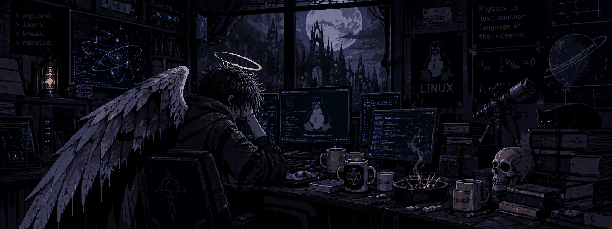

<!-- ===================================================== -->
<!-- MAIKITRAS | ABYSS LABORATORY                           -->
<!-- ===================================================== -->

<p align="center">
  
</p>

<p align="center">
<pre>
 ███╗   ███╗██╗   ██╗██╗  ██╗███████╗
 ████╗ ████║╚██╗ ██╔╝██║ ██╔╝██╔════╝
 ██╔████╔██║ ╚████╔╝ █████╔╝ █████╗
 ██║╚██╔╝██║  ╚██╔╝  ██╔═██╗ ██╔══╝
 ██║ ╚═╝ ██║   ██║   ██║  ██╗███████╗
 ╚═╝     ╚═╝   ╚═╝   ╚═╝  ╚═╝╚══════╝
</pre>
</p>

<p align="center">
  
</p>

<p align="center">
  <samp>
    SCIENTIFIC COMPUTING · CYBERSECURITY · PHYSICS
  </samp>
</p>

<p align="center">
  <i>
    "Between the laws of the universe and the vulnerabilities of machines."
  </i>
</p>

<p align="center">
  <samp> Find.  Understand. Curiosity. Knowledge.</samp>
</p>

<p align="center">
  
</p>

---

## `// 01. ABOUT ME`

```text
Name       : Call me Myke 
Field      : Physics / Scientific Computing
Environment: Linux / Windows
Interests  : Physics, Programming, Cybersecurity
Philosophy : Understand how things work.
```

I'm a physics student interested in the intersection between
fundamental science, computation and technology.

I enjoy understanding complex systems, exploring the logic
behind software and studying the physical principles that
describe our universe.

Currently exploring:

- Computational physics and materials science.
- Linux systems and cybersecurity.
- Software development and algorithms.
- Artificial intelligence and scientific simulations.

---

## `// 02. AREAS OF INTEREST`

<table>
<tr>
<td width="50%" valign="top">

### ⚛ PHYSICS

- Computational Physics
- Condensed Matter
- Quantum Mechanics
- Materials Science

</td>
<td width="50%" valign="top">

### ◈ CYBERSECURITY

- Ethical Hacking
- Network Security
- Linux Systems


</td>
</tr>
<tr>
<td width="50%" valign="top">

### ⌘ DEVELOPMENT

- C# / Python


</td>
<td width="50%" valign="top">

### ⌬ RESEARCH

- Scientific Computing
- Numerical Simulations

</td>
</tr>
</table>


---

## `// 03. PROJECTS & RESEARCH`

Here are some areas where I am developing projects and expanding
my technical knowledge.

```bash
$ ls ~/research/

computational-physics/
materials-science/
scientific-simulations/
software-development/
linux-experiments/
```

---


## `// 04. TERMINAL`

<p align="center">
  <samp>
    Somewhere, something incredible is waiting to be known.
  </samp>
</p>

<p align="center">
  <samp>
    [ SYSTEM ONLINE ] · [ ACCESS: PUBLIC ] · [ STATUS: EXPLORING ]
  </samp>
</p>


